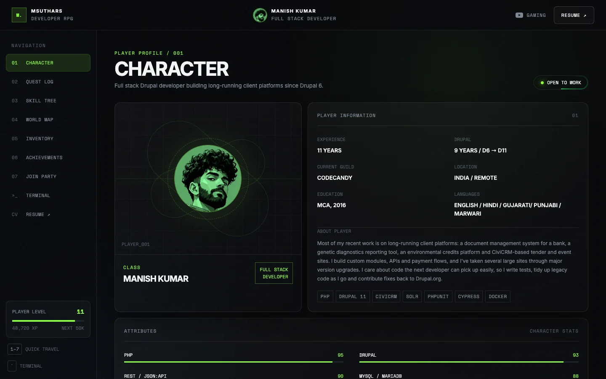
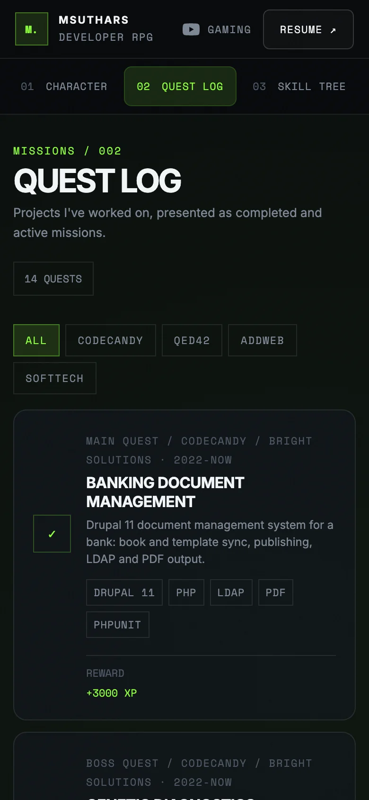

# MSUTHARS — Developer RPG

The portfolio of **Manish Kumar**, a full stack Drupal developer with 11 years of experience, built as a small role-playing game.

**🎮 Live site: [msuthars.github.io](https://msuthars.github.io/)** · **📄 [Resume](https://msuthars.github.io/resume/)**

<p>
  
  
</p>

## Features

- **RPG-style sections**: Character, Quest Log (projects), Skill Tree, World Map (career), Inventory (tech stack), Achievements and Contact
- **Command terminal**: press <kbd>\`</kbd> or <kbd>/</kbd> and type `help`. It has Tab completion, history and a few hidden commands
- **Bug Hunter**: a 30-second mini-game, from the Contact section or the `play` command
- **Contact form** in a modal, sent through [Web3Forms](https://web3forms.com)
- **Keyboard shortcuts**: <kbd>1</kbd>–<kbd>7</kbd> jump between sections
- **Real URLs for each section** (`/quests/`, `/skills/`…). Every page is pre-rendered, so it loads fast and search engines can read it
- **Printable resume** at [`/resume/`](https://msuthars.github.io/resume/), laid out for A4
- Works on phones and tablets, supports keyboard navigation and respects `prefers-reduced-motion`

## Tech stack

| | |
|---|---|
| UI | [React 18](https://react.dev) |
| Styling | [Tailwind CSS v4](https://tailwindcss.com) with design tokens in `@theme` |
| Routing | [React Router 7](https://reactrouter.com) |
| Build | [Vite 5](https://vite.dev) and a small server-side pre-render step |
| Hosting | GitHub Pages, deployed by GitHub Actions on every push to `main` |

## Run it locally

Requires **Node 20** (see `.nvmrc`).

```bash
nvm use          # switch to Node 20
npm install
npm run dev      # http://localhost:5173
```

```bash
npm run build    # production build into dist/
npm run preview  # serve the build locally
```

## Project structure

```
src/
  App.jsx               layout, routing and keyboard shortcuts
  data.js               all content: profile, quests, skills, map, links
  style.css             Tailwind theme and custom utilities
  components/           one component per section, plus modals, terminal and game
  components/resume/    the printable resume page
scripts/prerender.mjs   writes a pre-rendered HTML page for every route
```

Almost all of the content lives in `src/data.js`, so updating the portfolio rarely means touching a component.

## Contact

[LinkedIn](https://www.linkedin.com/in/msuthars/) · [Drupal.org](https://www.drupal.org/u/msuthars) · [GitHub](https://github.com/msuthars) · or use the contact form on the [live site](https://msuthars.github.io/contact/).
